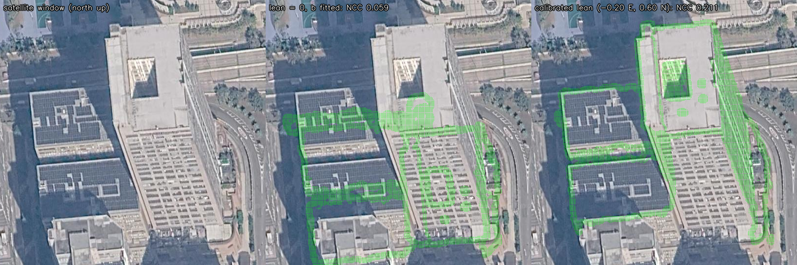
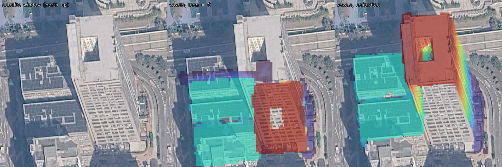
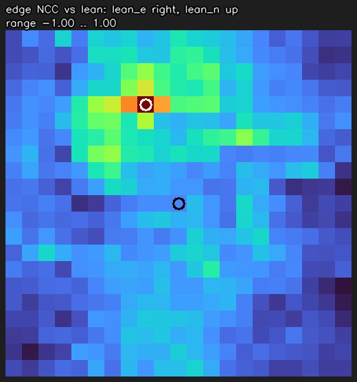
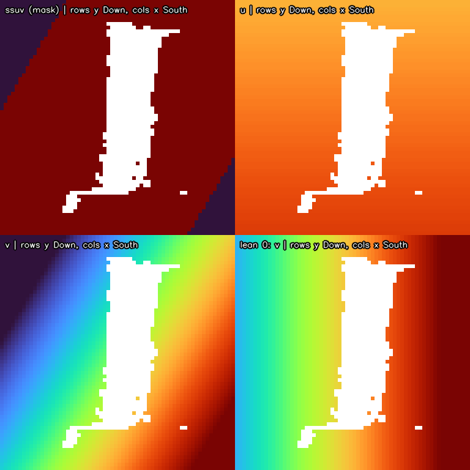
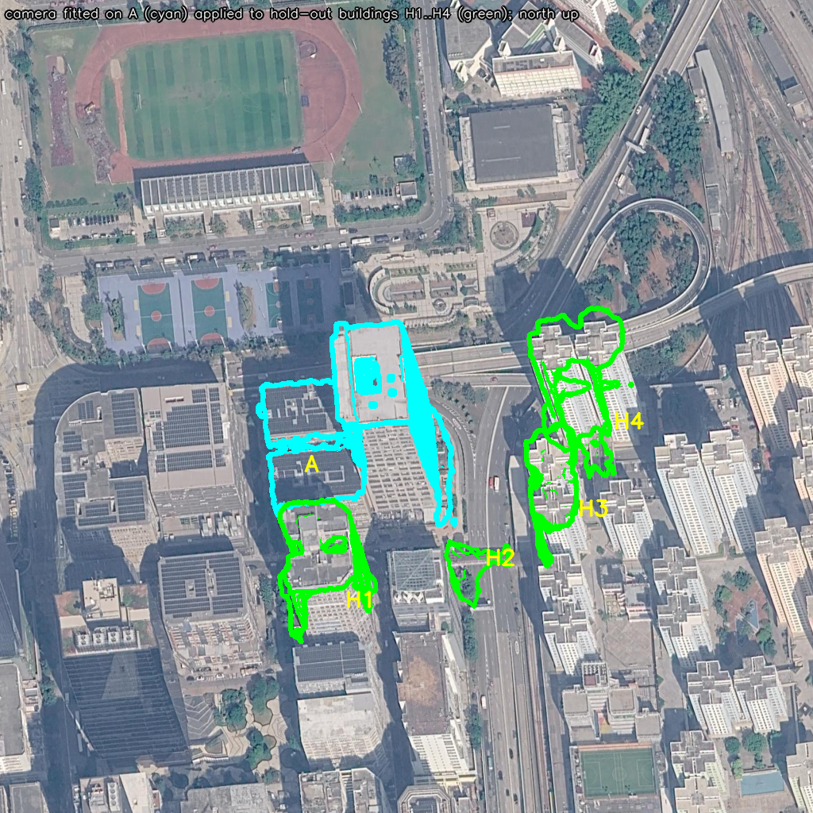
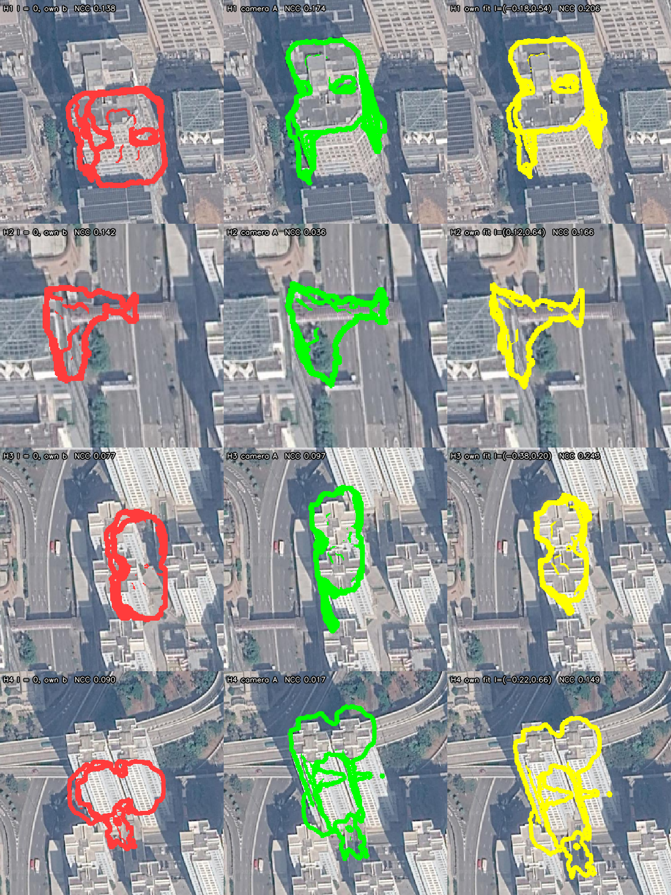

# sat-uv-volume

Ground-truth **satellite UV volume** of one building, computed from a 3D mesh of the building.

A UV volume (GenSfM / CUPID style, built on TRELLIS sparse structures) gives every voxel centre of a 64³ cube around the
building the normalised image coordinate (u, v) it projects to, plus a mask saying whether it lands inside the image.
For a satellite image this is not a plain orthographic projection: the image is a north-up map crop, but tall objects
**lean** (their roofs are displaced horizontally in proportion to height). This repository models the satellite image
as an affine "leaned" camera, calibrates that camera from the building mesh and the satellite image only, and writes
the UV volume.

## Output format

For a cube with centre `c` and side `S` (cube coordinates `p = (X - c) / S` in [-0.5, 0.5]³, axes = world axes) and
resolution R = 64, voxel (i, j, k) has its centre at `p = ((i, j, k) + 0.5) / R - 0.5` (meshgrid `'ij'`, as GenSfM's
`SparseUVStructure._get_uv_volume`). The satellite UV volume is saved as `satellite_<k>.npz`:

| key | shape | meaning |
|---|---|---|
| `uv_volume` | float32 [2, R, R, R] | (u, v) of every voxel centre in the satellite window, clamped to [0, 1] |
| `ssuv` | uint8 [1, R, R, R] | 1 where 0.01 ≤ u, v ≤ 0.99 on the unclamped values (GenSfM's `const_ssuv` mask) |
| `uv_raw` | float32 [2, R, R, R] | (u, v) before the clamp |
| `camera_cube` | float64 [2, 4] | affine camera in cube coordinates: `[u, v] = camera_cube @ [p, 1]` |

(u, v) are relative to the square satellite window (`satellite_<k>_crop.png`): origin at its top-left corner, 1 at the far
edge. `occupancy.npy` holds the occupied voxels (M, 3), voxelised like TRELLIS `dataset_toolkits/voxelize.py`.

## Install

```
pip install -r requirements.txt      # numpy, opencv-python, open3d (+ pytest)
```

## Usage

CrossGeo pair (the mesh must be in the flight's world frame "EDS": x South, y Down, z East, metres):

```
python examples/crossgeo_satellite.py --pair-dir PAIR_DIR --mesh building.ply --out OUT --sat-sides 2 --figures
```

Writes `OUT/cube.json`, `OUT/occupancy.npy`, `OUT/satellite_<k>.npz`, `OUT/satellite_<k>_crop.png`,
`OUT/satellite_<k>_calibration.json`, `OUT/cameras.json` and, with `--figures`, the figures shown below.

Python API (any north-up satellite image and a mesh in a metric ENU or EDS frame):

```python
from sat_uv import (SatelliteCamera, calibrate_satellite, window_around, cube_around, occupancy,
                    satellite_uv_volume, mercator_m_per_px)

cam0 = SatelliteCamera(width=W, height=H, m_per_px=mercator_m_per_px(lat, 19),
                       centre_e=E0, centre_n=N0, h0=mesh_base_up)          # image centre in world ENU metres
res = calibrate_satellite(image_rgb, cam0, vertices, faces, frame="eds")   # fits b and lean from the mesh
cam = res.camera
win = window_around(cam, vertices, "eds")                                  # building + 10% margin (>= 5 m)
cube = cube_around(vertices, pad=1.1)
vol = satellite_uv_volume(cam, win, cube, "eds", res=64)                   # uv_volume, ssuv, uv_raw, camera_cube
occ = occupancy(vertices, faces, cube, 64)
```

## Method (the experiment)

**1. Building mesh.** In our experiment there is no ground-truth mesh yet, so a stand-in was made from the UAV data of
the same flight: the UAV depth maps were back-projected with their poses, the points inside the building's footprint
(+3 m) kept, and a Poisson surface reconstructed (`docs/figures/uav_mesh_render.png`; points-to-mesh distance median 0.08 m,
p90 0.72 m). That builder is not part of this repository; any mesh in the flight frame can be used.

**2. Cube.** Axis-aligned, centred on the mesh's bounding box, side = 1.1 × its largest extent (131.9 m here, voxel
2.06 m, 7074 occupied voxels).

**3. Satellite camera.** With (E, N, U) local ENU metres and h = U − h0 the height above a datum (the mesh base):

```
col = (E - centre_e + b_e + lean_e * h) / m_per_px + width  / 2
row = (-(N - centre_n) - b_n - lean_n * h) / m_per_px + height / 2
```

(col, row) are continuous pixel coordinates (origin top-left, image right = East, down = South).

| parameter | meaning | source |
|---|---|---|
| `m_per_px` | ground resolution | Web-Mercator zoom 19: `156543.034 * cos(lat) / 2**19` |
| `centre_e, centre_n` | world position of the image centre | the street-view station's GPS position |
| `b_e, b_n` | ground offset (m): where ground content sits relative to that placement | **calibrated** |
| `lean_e, lean_n` | horizontal displacement East / North per metre of height | **calibrated** |

The map is affine in the world point (`SatelliteCamera.matrix`), so the labels are exactly affine (a least-squares
affine fit reproduces them to 1e-15).

**4. Geo-referencing** (checked on one Hong Kong flight of CrossGeo):
- The flight's world frame "EDS" (x South, y Down, z East) is a local tangent frame of WGS84 lat/lon/alt: over 96
  records spread 582 m × 173 m, rotation 0.002°, scale 0.999996, residual median 5 mm (max 12 mm).
- Each satellite PNG is a north-up Web-Mercator zoom-19 crop centred on the street-view station's GPS position: the
  dataset's original satellite camera of the checked pair sits 3 cm from the station and stores the station's lat/lon.
- `m_per_px` at 22.33° N = 0.27620 m/px; 500 m / 1810 px = 0.27624 m/px (0.015% apart).
- So: lat/lon/alt → local metres; station lat/lon → image centre; `(position − centre) / m_per_px` places ground points
  ("GPS + scale"); `b` absorbs the remaining offset (centre error, local positional error of the imagery);
  `lean · h` moves elevated points. `sat_uv/geo.py` has the conversions (`lla_to_enu`, `enu_to_lla`, `to_enu`,
  `mercator_m_per_px`).

**5. Calibration from the mesh** (`sat_uv/calibrate.py`, defaults in `CalibConfig`). Known: scale, north-up, centre.
Unknown: b_e, b_n, lean_e, lean_n.
1. Sample points uniformly on the mesh surface (12 per m², 0.3–1.5 M points, seed 1111).
2. For a candidate lean, project them with b = 0 onto a 0.5 m working grid; each cell keeps the **highest** point
   (seen from above, roofs hide what is below). Take the Sobel edges of this predicted height image and of its
   silhouette.
3. Take the Sobel gradient of the satellite image's luminance on the same grid.
4. Slide the predicted edges over the image gradient within ±12 m (normalised cross-correlation,
   `cv2.matchTemplate` `TM_CCOEFF_NORMED`): the best shift is b (sub-pixel), its score is the lean's score.
5. Coarse lean grid ±1.0 in steps of 0.1 (441 leans), then ±0.1 in steps of 0.02 around the best.

Absolute scores are low (~0.2) because the image has many edges the building does not explain (ground texture, shadows,
windows); what matters is the margin over lean = 0 and over the second-best peak.

**6. UV volume.** Each voxel centre → world → pixel with the calibrated camera → window (u, v); mask on the unclamped
values, then clamp.

## Example result (Hong Kong, CrossGeo scene 0501, flight 160_30, pair_83, satellite 2)

Satellite PNG 1810 × 1810 px, 0.2762 m/px.

| camera | lean_e | lean_n | b_e (m) | b_n (m) | edge NCC |
|---|---|---|---|---|---|
| calibrated on the mesh | −0.20 | 0.60 | −0.71 | 4.03 | 0.211 |
| lean = 0, b refitted | 0 | 0 | | | 0.059 |
| second-best coarse peak | −0.50 | 0.60 | | | 0.117 |

The calibrated lean equals the lean measured independently for the whole image from the UAV height surface in an
earlier pilot (−0.2, 0.6). A 100 m roof is displaced by 63 m; the occupied voxels move by 17 m on median (51 m max)
between lean = 0 and the calibrated camera.

**`docs/figures/satellite_2_1_mesh_edges.png`** — left: the satellite window (north up). The tower's roof (light
grey, square opening) appears ~60 m north of where the tower stands; the long window-grid strip south of the roof is the
south facade, the thin strip on the east is the east facade. Middle: green = predicted mesh edges for a straight-down
view (lean 0, b fitted) — they sit on the footprint and miss the roof. Right: calibrated camera — roof outline, opening,
facade edges and the two lower attached blocks line up.



**`docs/figures/satellite_2_2_voxels.png`** — occupied voxels drawn where their UV says, coloured by height above the
mesh base (blue low, red ~100 m). With lean 0 the red roof voxels cover the south facade; calibrated, they cover the roof
and the facade voxels form a red-to-blue band along the visible east facade. This is what the satellite UV volume
encodes.



**`docs/figures/satellite_2_3_score_map.png`** — edge NCC over the coarse lean grid (lean_e to the right, lean_n up);
white circle = calibrated lean, black = lean 0.



**`docs/figures/satellite_2_4_uv_slice.png`** — a vertical North–South slice of the UV volume through the tower
(columns: South to the right; rows: Down, so up is at the top); occupied voxels white. Panels: mask, u, v, and v with
lean 0. The v bands are slanted with the calibrated lean (higher voxels map further north) and vertical with lean 0 —
the difference is the lean in the labels. The mask is 0 where voxels project outside the window.



## Hold-out check: does one building's camera fit its neighbours?

The camera calibrated on the tower (A) was applied unchanged to four other buildings of the same satellite image
(each with its own stand-in mesh; made by an analysis script not included here). Columns of
`docs/figures/holdout_panels.png`: red = lean 0 with its own b, green = camera A as is, yellow = the building's own fit.

| building | distance to A | height | NCC: camera A / A's lean + own b / lean 0 + own b / own fit | own lean (E, N) | b difference with A's lean (E, N) m |
|---|---|---|---|---|---|
| H1 | 84 m S | 75 m | 0.174 / 0.196 / 0.138 / 0.206 | (−0.18, 0.54) | (−0.66, 0.43) |
| H2 | 92 m | 25 m | 0.036 / 0.116 / 0.142 / 0.166 | not measurable (second peak 0.163) | (−6.79, 1.35) |
| H3 | 132 m E | 43 m | 0.097 / 0.205 / 0.077 / 0.243 | not measurable (second peak 0.229) | (0.78, −5.40) |
| H4 | 153 m E | 82 m | 0.017 / 0.137 / 0.090 / 0.149 | (−0.22, 0.66) | (1.01, −8.27) |

- **Lean transfers**: the tall buildings' own leans are within 0.06 of A's (−0.20, 0.60).
- **b transfers only nearby**: < 1 m within 84 m, 5–8 m at 130–150 m (growing southwards towards the east). The UAV
  frame is not rotated against north (0.002°) and the dataset's satellite heading is 0.15° (0.4 m at 150 m), so the
  drift is most likely local positional error of the satellite imagery itself (mosaic / orthorectification) — not
  verified.
- Hence: **calibrate each building on itself** (what the example does).




## Using several satellite images

Verified:
- Every CrossGeo satellite PNG is cropped around its station's GPS position, Web-Mercator zoom 19 (0.2762 m/px),
  north-up, so the pixel offset of one ground point between two images follows exactly from their centres' lat/lon.
- The lean is nearly constant within an area: in a pilot, two pairs of the same scene gave the same lean (Osaka pair_13
  and pair_62 both 0.175; Hong Kong pair_83 and pair_88 both about 0.6), and the tall hold-out buildings were within
  0.06 of the tower.
- b varies within an area (< 1 m within 84 m, 5–8 m at 130–150 m).

Possible use:
1. **Share one lean over an area**, fitted on several buildings or images jointly — more stable, especially for low
   buildings whose own lean cannot be measured.
2. **b by position**: calibrate b once per building on one image; if the images are the same imagery, move to another
   image by the centre lat/lon difference without recalibrating. A smooth offset field fitted from many buildings is
   possible, but five buildings are not enough.
3. **Mosaic**: if they are the same imagery, stitch the images by GPS and scale into one mosaic and cut windows centred
   on each building, so a building at an image edge is not cut.

**Not yet verified (prerequisite):** whether different pairs' satellite PNGs are the same imagery (same capture and
mosaic). Check that overlapping images agree pixel-wise after GPS alignment. If they come from different dates or
sources, lean and b can differ and each image must be calibrated on its own.

## Limitations

- The example's mesh is a stand-in reconstructed from the same flight's UAV depth (Poisson fills unseen facades), and
  the camera is calibrated against it, so the overlays partly validate themselves; a common error of the UAV frame would
  be absorbed into b. An independent ground-truth mesh is needed for an accuracy claim.
- One building constrains its roof position (b + lean·H) strongly and its base (b) weakly: for H1, its own fit and
  camera A differ by 0.8 m at the roof and 4.7 m at the base.
- One horizontal height datum (the mesh base) is used, which keeps the label exactly affine; there are no rotation or
  scale terms (north-up and the Mercator scale are taken as exact).
- The window holds the projected mesh plus 10% (at least 5 m); cube voxels outside it get mask 0.

## Tests

```
pytest -q
```

Geo conversions and Mercator scale; camera axes, lean and offset signs, the 2×4 matrix in ENU and EDS; voxel layout,
mask-before-clamp, satellite UV volume = camera projection and = `camera_cube`; occupancy; synthetic calibration
(rendered boxes with known lean and b) recovers lean within 0.05 and b within 0.75 m; the CrossGeo reader. Each of eight
code mutations (sign flips, lowest-wins rendering, mask after clamp, voxel centre offset, u/v swap, frame axis) makes a
test fail.

## Attribution

Satellite and Google Earth imagery in `docs/figures` © Google; the figures are internal research documentation.
